<!-- Artwork is generated: edit scripts/build.mjs, then run `node scripts/build.mjs`. -->

<a href="https://qinxi-ai.github.io/"><picture><source media="(prefers-color-scheme: dark)" srcset="assets/hero-dark.svg"></picture></a>

  <a href="https://qinxi-ai.github.io/"><b>Research archive</b></a> &nbsp;·&nbsp;
  <a href="https://arxiv.org/abs/2608.19269">arXiv paper</a> &nbsp;·&nbsp;
  <a href="https://github.com/search?q=is%3Apr+author%3AQinXi-ai+is%3Amerged+is%3Apublic&type=pullrequests">Merged pull requests</a> &nbsp;·&nbsp;
  <a href="mailto:3624951962qx@gmail.com">Email</a>

<a href="https://github.com/search?q=is%3Apr+author%3AQinXi-ai+is%3Amerged+is%3Apublic&type=pullrequests"><picture><source media="(prefers-color-scheme: dark)" srcset="assets/stats-dark.svg"></picture></a>
<picture><source media="(prefers-color-scheme: dark)" srcset="assets/stack-dark.svg"></picture>

 

<picture><source media="(prefers-color-scheme: dark)" srcset="assets/section-research-dark.svg"></picture>

<a href="https://arxiv.org/abs/2608.19269"><picture><source media="(prefers-color-scheme: dark)" srcset="assets/paper-dark.svg"></picture></a>

 

<picture><source media="(prefers-color-scheme: dark)" srcset="assets/section-contrib-dark.svg"></picture>

<a href="https://github.com/apache/datafusion/pull/25150"><picture><source media="(prefers-color-scheme: dark)" srcset="assets/pr-1-dark.svg"></picture></a> <a href="https://github.com/pydata/xarray/pull/11552"><picture><source media="(prefers-color-scheme: dark)" srcset="assets/pr-2-dark.svg"></picture></a>

<a href="https://github.com/awslabs/stickler/pull/284"><picture><source media="(prefers-color-scheme: dark)" srcset="assets/pr-3-dark.svg"></picture></a> <a href="https://github.com/lacs-project/sysknife/pull/514"><picture><source media="(prefers-color-scheme: dark)" srcset="assets/pr-4-dark.svg"></picture></a>

<a href="https://github.com/AndreaBozzo/dataprof/pull/655"><picture><source media="(prefers-color-scheme: dark)" srcset="assets/pr-5-dark.svg"></picture></a> <a href="https://github.com/3b1b/manim/pull/2501"><picture><source media="(prefers-color-scheme: dark)" srcset="assets/pr-6-dark.svg"></picture></a>

<a href="https://github.com/search?q=is%3Apr+author%3AQinXi-ai+is%3Amerged+is%3Apublic&type=pullrequests"><code>All 58 merged pull requests →</code></a>

<picture><source media="(prefers-color-scheme: dark)" srcset="assets/section-work-dark.svg"></picture>

<a href="https://github.com/QinXi-ai/evalspec-audit"><picture><source media="(prefers-color-scheme: dark)" srcset="assets/work-1-dark.svg"></picture></a> <a href="https://github.com/FastR-D/FastRead"><picture><source media="(prefers-color-scheme: dark)" srcset="assets/work-2-dark.svg"></picture></a>

<a href="https://github.com/open-vela/contest2026_477_smartband"><picture><source media="(prefers-color-scheme: dark)" srcset="assets/work-3-dark.svg"></picture></a> <a href="https://github.com/QinXi-ai/moonguard"><picture><source media="(prefers-color-scheme: dark)" srcset="assets/work-4-dark.svg"></picture></a>

<a href="https://github.com/QinXi-ai/astrotwin-demo"><picture><source media="(prefers-color-scheme: dark)" srcset="assets/work-5-dark.svg"></picture></a> <a href="https://github.com/QinXi-ai/openvela-smarthome-agent"><picture><source media="(prefers-color-scheme: dark)" srcset="assets/work-6-dark.svg"></picture></a>

 

<picture><source media="(prefers-color-scheme: dark)" srcset="assets/section-awards-dark.svg"></picture>

<a href="https://qinxi-ai.github.io/#recognition"><picture><source media="(prefers-color-scheme: dark)" srcset="assets/awards-dark.svg"></picture></a>

 

<a href="mailto:3624951962qx@gmail.com"><picture><source media="(prefers-color-scheme: dark)" srcset="assets/principles-dark.svg"></picture></a>

<i>Nullius in verba.</i> &nbsp;·&nbsp; <a href="https://qinxi-ai.github.io/">qinxi-ai.github.io</a>

