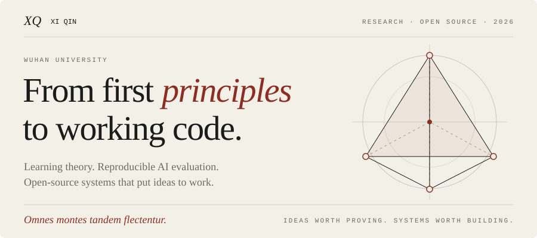

<!-- Artwork is generated: edit scripts/build.mjs, then run `node scripts/build.mjs`. -->

<a href="https://qinxi-ai.github.io/"><picture><source media="(prefers-color-scheme: dark)" srcset="assets/hero-dark.svg"></picture></a>

  <a href="https://qinxi-ai.github.io/"><b>Personal website</b></a> &nbsp;·&nbsp;
  <a href="#failure-steps-are-not-repair-intents">Latest paper</a> &nbsp;·&nbsp;
  <a href="https://github.com/search?q=is%3Apr+author%3AQinXi-ai+is%3Amerged+is%3Apublic+-user%3AQinXi-ai&type=pullrequests">Merged pull requests</a> &nbsp;·&nbsp;
  <a href="mailto:3624951962qx@gmail.com">Email</a>

<a href="https://github.com/search?q=is%3Apr+author%3AQinXi-ai+is%3Amerged+is%3Apublic+-user%3AQinXi-ai&type=pullrequests"><picture><source media="(prefers-color-scheme: dark)" srcset="assets/stats-dark.svg"></picture></a>

Research &amp; open-source snapshot updated 25 November 2026 · Public merged PRs outside my personal namespace

## 01 / Selected research

### Failure Steps Are Not Repair Intents: Measuring Actionable Ambiguity in Multi-Agent System Diagnosis

**WSDM 2027 Findings · Accepted · First author: Xi Qin**

Do different blamed execution steps imply different repairs? We study expert-recommended actions from MP-Bench through a prediction-blind, human-audited model-assisted analysis of **96 multi-agent traces** and **1,436 actions**.

In the primary analysis, **85.1% of traces** contain fewer distinct repair intents than blamed steps, while top repair-set alignment reaches **95.7%**. The findings show how step-level evaluation can overstate actionable diversity while often preserving the first repair priority.

### [Instance-Optimal Identity Testing at the Original Total-Variation Radius: Resolving Canonne's 2024 Open Question 1](https://zenodo.org/records/23584756)

**Latest preprint · Distribution testing · 23 October 2026**

How many samples are needed to test whether an unknown distribution equals a specified reference—at the total-variation radius actually given? I give an explicit characterization, up to universal constants, for every finite or countable reference distribution at the original radius.

The preprint resolves **Canonne's COLT 2024 Open Question 1** in the countable-alphabet model, with matching upper and lower bounds and a polynomial-time factor-two approximation for explicit rational input.

[Read the paper ↗](https://zenodo.org/records/23584756/files/instance_optimal_identity_testing_v1.pdf) · [LaTeX source ↓](https://zenodo.org/records/23584756/files/instance_optimal_identity_testing_v1_source.zip) · [Lean 4 proof (530 modules) ↗](https://github.com/QinXi-ai/identity-testing-lean) · [DOI: 10.5281/zenodo.23584756](https://doi.org/10.5281/zenodo.23584756)

### [Exact Three-Example Selection in Every Dimension](https://zenodo.org/records/23119254)

**Preprint · Learning theory · 3 October 2026**

How much can you lose by keeping just three examples? I determine the exact worst-case risk inflation for mean regression when selecting three support points, with repetition allowed, and predicting their equally weighted mean—in every dimension.

The result resolves the **n = 3 column** of the data-selection question posed at COLT 2025, with sharp constants and a characterization of the extremal geometry.

[Read the paper ↗](https://zenodo.org/records/23119254/files/exact-three-example-selection.pdf) · [Source & verification scripts ↓](https://zenodo.org/records/23119254/files/exact-three-example-selection-source-v1.0.zip) · [DOI: 10.5281/zenodo.23119254](https://doi.org/10.5281/zenodo.23119254)

### [What Does an Evaluation License?](https://arxiv.org/abs/2608.19269)

**Preprint · AI evaluation · arXiv:2608.19269 · v3**

*A Commit-Bound Census of Claim-Relative Inference in Inspect Evals.*
A framework for connecting evaluation artifacts to the claims they support. The census records **124 eligible units**, **14 deterministic analyses**, and **110 typed stops** that identify missing evidence.

[Read on arXiv ↗](https://arxiv.org/abs/2608.19269) · [Code ↗](https://github.com/QinXi-ai/evalspec-audit)

## 02 / Open-source contributions

**31 PRs merged since 20 October.** Selected work across Blackwell GPU kernels, query engines, developer tools, scientific computing, and agent security.

| Project | Contribution | Merged |
| :--- | :--- | :--- |
| **dllm-labs/mojo-dllm** | [Calibrate DiffusionGemma parity on fixed reference inputs · #175](https://github.com/dllm-labs/mojo-dllm/pull/175) | 2026-11-24 |
| **lacs-project/sysknife** | [Export both audit chains and verify them offline · #786](https://github.com/lacs-project/sysknife/pull/786) | 2026-11-15 |
| **apache/datafusion** | [Add opt-in native grouped integer DISTINCT counts · #25988](https://github.com/apache/datafusion/pull/25988) | 2026-11-08 |
| **dllm-labs/mojo-dllm** | [Batch long GQA loads without changing softmax order · #73](https://github.com/dllm-labs/mojo-dllm/pull/73) | 2026-11-04 |
| **dllm-labs/mojo-dllm** | [Tune Q4_K tile dispatch for RTX Blackwell · #71](https://github.com/dllm-labs/mojo-dllm/pull/71) | 2026-11-03 |
| **apache/datafusion** | [Serialize lazy generators through hooks · #25765](https://github.com/apache/datafusion/pull/25765) | 2026-10-19 |
| **microsoft/vscode-eslint** | [Keep linting inside the workspace · #2227](https://github.com/microsoft/vscode-eslint/pull/2227) | 2026-10-16 |
| **pydata/xarray** | [Bring apply_ufunc to DataTree · #11552](https://github.com/pydata/xarray/pull/11552) | 2026-09-09 |

Also recently merged: [SysKnife #828 — pin MCP publisher and scan all CI workflows](https://github.com/lacs-project/sysknife/pull/828) (20 Nov) · [mojo-dllm #133 — Q5_0/Q8_0 CPU tiles and grouped MoE](https://github.com/dllm-labs/mojo-dllm/pull/133) (4 Nov).

[Browse all 98 public merged PRs →](https://github.com/search?q=is%3Apr+author%3AQinXi-ai+is%3Amerged+is%3Apublic+-user%3AQinXi-ai&type=pullrequests)

## 03 / Selected projects

**[identity-testing-lean](https://github.com/QinXi-ai/identity-testing-lean)** · `LEAN 4` 
530-module Lean 4 formalization of instance-optimal identity testing at the original TV radius, with certified rational interval evaluation.

**[Pocket MOSS Image](https://github.com/QinXi-ai/pocket-moss-image)** · `PYTHON / PYTORCH` 
Low-memory MOSS-Image inference: the original 9B text encoder with packed INT6 weights and a streamed, fused INT8 DiT. No retraining or replacement encoder.

**[evalspec-audit](https://github.com/QinXi-ai/evalspec-audit)** · `PYTHON` 
Reproducible audits of how evaluation choices affect scores, rankings, and the claims a benchmark supports.

**[FastRead](https://github.com/FastR-D/FastRead)** · `PYTHON / TS` 
A paper-reading workspace with page-linked evidence, reports, notes, and conversations grounded in the original PDF.

**[MoonCat · 月薪喵](https://github.com/open-vela/contest2026_477_smartband)** · `C / OPENVELA` 
An openvela wearable recovery coach: LVGL interface, scheduled reminders, and on-device INT8 intent routing.

**[moonguard](https://github.com/QinXi-ai/moonguard)** · `MOONBIT` 
Public API compatibility checks and semantic-versioning safeguards for MoonBit libraries.

**[AstroTwin](https://github.com/QinXi-ai/astrotwin-demo)** · `JAVASCRIPT` 
A browser-based astronomy research demo with TESS evidence snapshots, guided analyses, and Qwen-assisted planning.

**[openvela-smarthome-agent](https://github.com/QinXi-ai/openvela-smarthome-agent)** · `C / OPENVELA` 
A smart-home agent with simulated devices, a DeepSeek tool-calling loop, and a reproducible offline mode.

## 04 / Recognition

| 2026 competition / 竞赛 | Award / 奖项 |
| :--- | :--- |
| CCF Open Source Innovation Competition · openvela Smart Band Track CCF 开源创新大赛 · 智能手环赛道 | **First Prize** 一等奖 |
| CCF Quantum Computing Programming Challenge · Origin Quantum Cup CCF 量子计算编程挑战赛 · 本源杯 | **First Prize** 一等奖 |
| National Electrical Mathematical Modeling · CSEE Cup · “Diangong Cup” 全国大学生电工数学建模竞赛 · 电工杯 | **Second Prize** 二等奖 |
| CCF Open Source Innovation Competition · openvela Smart Home Track CCF 开源创新大赛 · 智能家居赛道 | **Third Prize** 三等奖 |

[Competition background & details / 赛事介绍 →](https://qinxi-ai.github.io/#recognition)

---

**Works in** Rust · Python · Mojo · Lean 4 · TypeScript · C · MoonBit · openvela / LVGL

*Nihil ultra testimonium.* — Nothing beyond the evidence.

<i>Nullius in verba.</i> &nbsp;·&nbsp; <a href="https://qinxi-ai.github.io/">qinxi-ai.github.io</a>

